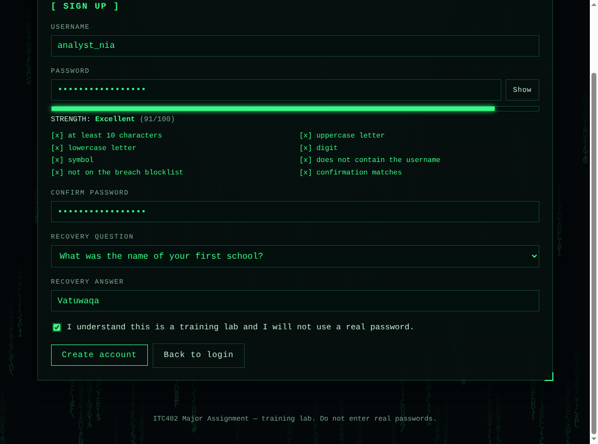
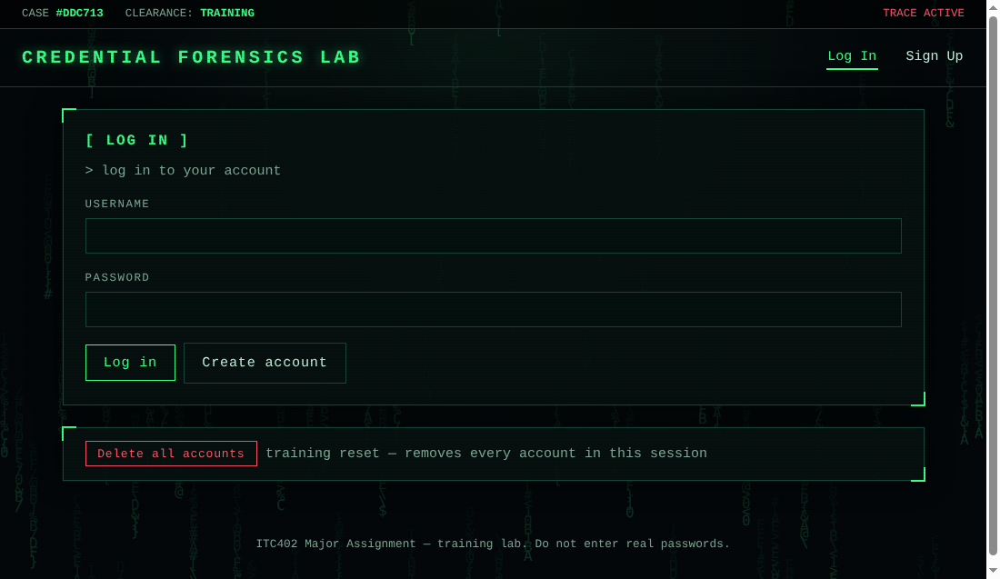
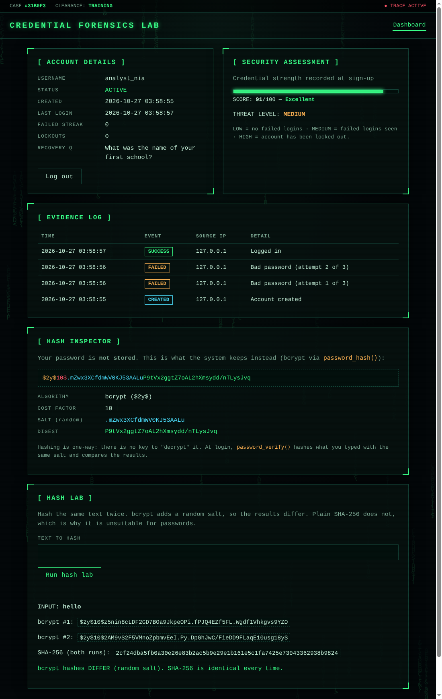
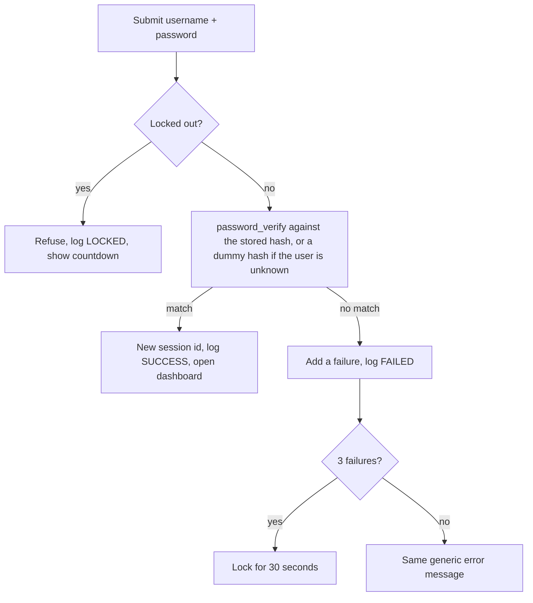

<p align="center">
  
</p>

<p align="center">
  <b>A hands-on lab that shows how a website should check, store and protect passwords.</b>
</p>

<p align="center">
  <a href="https://credential-forensics-lab.onrender.com">
    
  </a>
  
  
  
  
  
</p>

<p align="center">
  <a href="#mission">Mission</a> &nbsp;|&nbsp;
  <a href="#screenshots">Screenshots</a> &nbsp;|&nbsp;
  <a href="#features">Features</a> &nbsp;|&nbsp;
  <a href="#quick-start">Quick start</a> &nbsp;|&nbsp;
  <a href="#tests">Tests</a> &nbsp;|&nbsp;
  <a href="#project-files">Files</a> &nbsp;|&nbsp;
  <a href="#known-limits">Limits</a>
</p>

```text
> training lab  |  no database (PHP sessions only)  |  never enter a real password
```



## Mission

Most people only see the login box. This lab opens up everything behind it: create an account, break the rules on purpose, get locked out, then inspect what the system actually stored about you.

| You do this | The lab shows you this |
|---|---|
| Type a password | A **live strength meter**, then the same rules re-checked by PHP |
| Try `P@ssw0rd!2024` | The **breach blocklist** sees through the "leet speak" and rejects it |
| Fail to log in 3 times | A **30-second lockout** with a ticking countdown |
| Log in successfully | A dashboard with **threat level, score and evidence log** |
| Open the Hash Inspector | The 60-character **bcrypt hash** split into algorithm, cost, salt and digest |
| Hash `hello` twice in the Hash Lab | Two **different** bcrypt hashes, but **identical** SHA-256 |

## Screenshots

<table>
  <tr>
    <td width="33%" valign="top"><a href="docs/screenshot-signup.png"></a></td>
    <td width="33%" valign="top"><a href="docs/screenshot-login.png"></a></td>
    <td width="33%" valign="top"><a href="docs/screenshot-dashboard.png"></a></td>
  </tr>
  <tr>
    <td align="center"><sub><b>Sign Up</b><br>live strength meter</sub></td>
    <td align="center"><sub><b>Log In</b><br>lockout + countdown</sub></td>
    <td align="center"><sub><b>Dashboard</b><br>evidence log + hashes</sub></td>
  </tr>
</table>


## Features

| Area | What it does |
|---|---|
| **Pages** | `login.php` (Log In), `register.php` (Sign Up), `dashboard.php` (login required) |
| **Password rules** | 10-64 characters with upper, lower, digit and symbol; must not contain the username; confirmation must match |
| **Breach blocklist** | Rejects common passwords, even with substitutions (`@`=a, `0`=o, `$`=s) |
| **Live meter** | JavaScript strength score and checklist while you type (PHP re-checks everything) |
| **Hashing** | `password_hash()` (bcrypt, random salt) and `password_verify()`; recovery answers are hashed too |
| **Lockout** | 3 failed logins lock the account for 30 seconds; the right password is refused while locked |
| **No user enumeration** | "Wrong password" and "unknown user" give the same message; a dummy hash evens out response time |
| **Session hardening** | New session id after login and logout, HttpOnly + SameSite cookies, security headers |
| **Dashboard** | Account details, strength score, threat level, evidence log, Hash Inspector, Hash Lab |
| **CI/CD Deployment** | Fully containerized and auto-deployed via Render connected to GitHub. |

<details>
<summary><b>How a login is decided</b> (flow diagram)</summary>



</details>

## Quick start

```bash
git clone https://github.com/Shaniya18/credential-forensics-lab.git
cd credential-forensics-lab
```

<details>
<summary><b>Option A:</b> Live Cloud Deployment (Render)</summary>

The application is live and deployed via Docker to Render.

👉 **[Click here to open the live app](https://credential-forensics-lab.onrender.com)** 👈

*(Note: Because this is hosted on Render's free tier, the container spins down after 15 minutes of inactivity. The first request may take 50 seconds to wake it up.)*
</details>

<details>
<summary><b>Option B:</b> PHP built-in server (needs PHP 8.1+)</summary>

```bash
php -S localhost:8000
```

Open <http://localhost:8000>.

</details>

<details>
<summary><b>Option C:</b> Docker (Local)</summary>

```bash
docker build -t credential-forensics-lab .
docker run -d --name forensics-app -p 8080:80 credential-forensics-lab
```

Open <http://localhost:8080>. Stop it with `docker stop forensics-app && docker rm forensics-app`.

</details>

<details>
<summary><b>Try it in 60 seconds</b></summary>

1. Click **Sign Up** and use the username `analyst_nia` with the password `Vault#Raven-9271!`
2. Watch the meter reach **Excellent** and tick every box.
3. Create the account, log in, and open the **Hash Inspector**.
4. Log out, then fail three logins on purpose and watch the lockout countdown.

</details>


## Tests

17 Selenium tests (Python `unittest` + WebDriver) drive a real Chrome browser through every page, covering success and failure paths.

```bash
pip install -r requirements.txt
python tests/test_forensics.py
```

Use `BASE_URL` to point at Render, XAMPP, or Docker, and `SLOW=0.7` to watch the browser work. Results are saved to `tests/test_results.txt`. Needs Python 3.9+ and Google Chrome.

```powershell
# Test against your live Render deployment
$env:BASE_URL="https://credential-forensics-lab.onrender.com"
$env:SLOW="0.7"
python tests\test_forensics.py
```

<details>
<summary><b>See all 17 test cases</b></summary>

| # | Test | Expected result |
|--:|---|---|
| 1 | Log in page loads with its form fields | Success |
| 2 | Navigation between pages, index redirect | Success |
| 3 | Dashboard refuses visitors who are not logged in | Blocked |
| 4 | Valid sign-up accepted | Success |
| 5 | Empty sign-up form lists every missing item | Rejected |
| 6 | Common password rejected, including leet speak | Rejected |
| 7 | Password containing the username rejected | Rejected |
| 8 | Confirmation mismatch rejected | Rejected |
| 9 | Duplicate username rejected | Rejected |
| 10 | Live strength meter and checklist update while typing | Success |
| 11 | Successful login shows the dashboard | Success |
| 12 | Wrong password and unknown user give the same message | Denied |
| 13 | Lockout after 3 failures, countdown ticks, correct password refused | Locked |
| 14 | Hash Inspector shows a 60-character bcrypt hash, not the password | Success |
| 15 | Hash Lab: different bcrypt salts, identical SHA-256 | Success |
| 16 | Logout protects the dashboard again | Success |
| 17 | Delete-all-accounts with confirm dialog (cancel, then accept) | Success |

</details>

## Project files

<details>
<summary><b>Show the file list</b></summary>

| File or folder | Purpose |
|---|---|
| `index.php` | Redirects to login or dashboard |
| `login.php` | Login, lockout, delete-all-accounts |
| `register.php` | Sign-up form and server-side validation |
| `dashboard.php` | Account details, evidence log, Hash Inspector, Hash Lab |
| `includes/bootstrap.php` | Session, constants, password rules, scoring, helpers |
| `includes/header.php`, `footer.php` | Page top, navigation and bottom |
| `includes/common_passwords.php` | The breach blocklist |
| `assets/style.css` | Dark terminal theme |
| `assets/script.js` | Strength meter, countdown, falling-code background |
| `tests/test_forensics.py` | Selenium suite (17 tests) |
| `tests/test_results.txt` | Latest test run |
| `docs/` | Banner and screenshots used by this README |
| `Dockerfile` | `php:8.3-apache` container |
| `git_workflow.sh`, `git_workflow.ps1` | Create the commit, branch and merge history |

</details>

## Known limits

<details>
<summary><b>Why this is a demo, not production</b></summary>

1. **No database.** Accounts live in the PHP session and vanish when it ends. A real system stores hashes in a database.
2. **Lockout is per session.** A real system tracks failures per account and per IP, server-wide.
3. **No CSRF tokens.** A real login form needs them.
4. **No HTTPS.** Local development only. Production must use TLS. (Render handles HTTPS automatically on the live deployment).
5. **Sleeps on Render.** The free tier sleeps after 15 mins of inactivity.

</details>


<p align="center">
  <sub>Built for the ITC402 Major Assignment &nbsp;|&nbsp; PHP &nbsp;|&nbsp; Selenium &nbsp;|&nbsp; Docker &nbsp;|&nbsp; Git &nbsp;|&nbsp; Render</sub>
</p>
