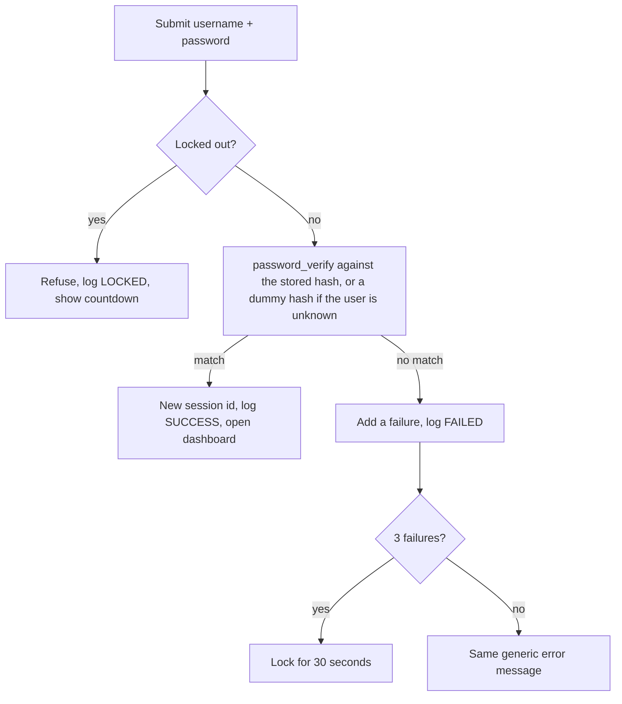

<p align="center">
  
</p>

<p align="center">
  <b>A hands-on lab that shows how a website should check, store and protect passwords.</b>
</p>

<p align="center">
  
  
  
  
  
</p>

```text
> status ........ TRAINING LAB
> database ...... none (PHP sessions only)
> data kept ..... until the browser session ends
> real passwords  DO NOT ENTER ANY
```

---

## 💗 `[ THE MISSION ]`

Most people only see the login box. This lab opens up everything behind it: you create an account, try to break the rules, fail on purpose, get locked out, and then inspect exactly what the system stored about you.

| You do this | The lab shows you this |
|---|---|
| Type a password | A **live strength meter** and rule checklist, then the same rules re-checked by PHP |
| Try `P@ssw0rd!2024` | The **breach blocklist** sees through the "leet speak" and rejects it |
| Fail to log in 3 times | A **30-second lockout** with a ticking countdown |
| Log in successfully | A dashboard with **threat level, score and an evidence log** |
| Open the Hash Inspector | The 60-character **bcrypt hash** split into algorithm, cost, salt and digest |
| Hash `hello` twice in the Hash Lab | Two **different** bcrypt hashes, but **identical** SHA-256 |

---

## 🌸 `[ SCREENSHOTS ]`

<table>
  <tr>
    <td width="50%"></td>
    <td width="50%"></td>
  </tr>
  <tr>
    <td align="center"><sub><b>Sign Up</b>: live strength meter and rule checklist</sub></td>
    <td align="center"><sub><b>Log In</b>: lockout and delete-all-accounts reset</sub></td>
  </tr>
</table>

<p align="center">
  
  <br>
  <sub><b>Dashboard</b>: account details, security assessment, evidence log, hash inspector and hash lab</sub>
</p>

---

## 🎀 `[ FEATURES ]`

### Pages

| Page | File | Purpose |
|---|---|---|
| **Log In** | `login.php` | Authenticate, lockout logic, delete-all-accounts reset |
| **Sign Up** | `register.php` | Account form with live meter and server-side validation |
| **Dashboard** | `dashboard.php` | Account details, security score, evidence log, Hash Inspector, Hash Lab (login required) |

### Password rules (checked twice: in JavaScript for feedback, in PHP for real)

- 10 to 64 characters, with an uppercase letter, a lowercase letter, a digit and a symbol
- Must not contain the username
- Must not match the **breach blocklist**, including simple substitutions (`@`→`a`, `0`→`o`, `$`→`s`)
- Confirmation must match

### Security behaviour

- **Hashing, not encryption:** `password_hash()` (bcrypt, random salt) and `password_verify()`. Recovery answers are hashed too.
- **Lockout:** 3 failed logins lock the account for 30 seconds. The right password is refused while locked.
- **No user enumeration:** "wrong password" and "unknown user" give the same message, and a dummy hash keeps response times similar.
- **Session hardening:** `session_regenerate_id()` after login and logout, HttpOnly + SameSite cookies, basic security headers.
- **Server is the authority:** every rule the browser shows is checked again in PHP.

### How a login is decided



---

## 💖 `[ QUICK START ]`

```bash
git clone https://github.com/Shaniya18/credential-forensics-lab.git
cd credential-forensics-lab
```

<details>
<summary><b>Option A: PHP built-in server</b> (needs PHP 8.1+)</summary>

```bash
php -S localhost:8000
```

Open <http://localhost:8000>.
</details>

<details>
<summary><b>Option B: XAMPP on Windows</b></summary>

1. Put the folder in `C:\xampp\htdocs\` so that `C:\xampp\htdocs\credential-forensics-lab\login.php` exists (no extra nested folder).
2. Start **Apache** in the XAMPP Control Panel.
3. Open <http://localhost/credential-forensics-lab/>.
</details>

<details>
<summary><b>Option C: Docker</b></summary>

```bash
docker build -t credential-forensics-lab .
docker run -d --name forensics-app -p 8080:80 credential-forensics-lab
```

Open <http://localhost:8080>. Stop it with `docker stop forensics-app && docker rm forensics-app`.
</details>

### Try it in 60 seconds

1. Click **Sign Up** and use the username `analyst_nia` with the password `Vault#Raven-9271!`
2. Watch the meter reach **Excellent** and tick every box.
3. Create the account, log in, and open the **Hash Inspector**.
4. Log out. Then fail three logins on purpose and watch the lockout countdown.

---

## 🌸 `[ AUTOMATED TESTS ]`

17 Selenium tests (Python `unittest` + WebDriver) drive a real Chrome browser through every page, covering success and failure paths.

```bash
pip install -r requirements.txt
python tests/test_forensics.py
```

Point the tests at another address with `BASE_URL` (no trailing slash). `SLOW` pauses after each action so you can watch.

```powershell
$env:BASE_URL="http://localhost/credential-forensics-lab"   # XAMPP
$env:BASE_URL="http://localhost:8080"                       # Docker
$env:SLOW="0.7"
python tests\test_forensics.py
```

Results are saved to `tests/test_results.txt`. Requirements: Python 3.9+ and Google Chrome.

<details>
<summary><b>See all 17 test cases</b></summary>

| # | Test | Path |
|--:|---|:-:|
| 1 | Log in page loads with its form fields | ✅ |
| 2 | Navigation between pages, index redirect | ✅ |
| 3 | Dashboard refuses visitors who are not logged in | ❌ blocked |
| 4 | Valid sign-up accepted | ✅ |
| 5 | Empty sign-up form lists every missing item | ❌ rejected |
| 6 | Common password rejected, including leet speak | ❌ rejected |
| 7 | Password containing the username rejected | ❌ rejected |
| 8 | Confirmation mismatch rejected | ❌ rejected |
| 9 | Duplicate username rejected | ❌ rejected |
| 10 | Live strength meter and checklist update while typing | ✅ |
| 11 | Successful login shows the dashboard | ✅ |
| 12 | Wrong password and unknown user give the same message | ❌ denied |
| 13 | Lockout after 3 failures, countdown ticks, correct password refused | ❌ locked |
| 14 | Hash Inspector shows a 60-character bcrypt hash, not the password | ✅ |
| 15 | Hash Lab: different bcrypt salts, identical SHA-256 | ✅ |
| 16 | Logout protects the dashboard again | ✅ |
| 17 | Delete-all-accounts with confirm dialog (cancel, then accept) | ✅ |

</details>

---

## 🎀 `[ PROJECT MAP ]`

```text
credential-forensics-lab/
├── index.php               redirects to login or dashboard
├── login.php               login, lockout, delete-all-accounts
├── register.php            sign-up form + server-side validation
├── dashboard.php           account details, evidence log, hash inspector, hash lab
├── includes/
│   ├── bootstrap.php       session, constants, password rules, scoring, helpers
│   ├── header.php          page top + navigation
│   ├── footer.php          page bottom + script loader
│   └── common_passwords.php   the breach blocklist
├── assets/
│   ├── style.css           dark terminal theme
│   └── script.js           strength meter, countdown, falling-code background
├── docs/                   banner and screenshots for this README
├── tests/
│   ├── test_forensics.py   Selenium suite (17 tests)
│   └── test_results.txt    latest run
├── Dockerfile              php:8.3-apache
├── git_workflow.sh         commit / branch / merge history (Git Bash, Mac, Linux)
└── git_workflow.ps1        the same for Windows PowerShell
```

---

## 💖 `[ KNOWN LIMITS ]`

This is a teaching demo. Each limit below is also a reason real systems work differently:

1. **No database.** Accounts live in the PHP session and vanish when it ends. A real system stores hashes in a database.
2. **Lockout is per session.** A real system tracks failures per account and per IP, server-wide.
3. **No CSRF tokens.** A real login form needs them.
4. **No HTTPS.** Local development only. Production must use TLS.

---

<p align="center">
  <sub>Built for the ITC402 Major Assignment · PHP · Selenium · Docker · Git</sub>
</p>
